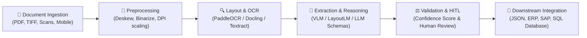

  

# 📑 Awesome Intelligent Document Processing (IDP) 🚀

  
  
  
  
  
  
  

---

## 📖 Executive Summary & SEO Overview

**Intelligent Document Processing (IDP)** represents the convergence of **Optical Character Recognition (OCR)**, **Computer Vision (CV)**, **Natural Language Processing (NLP)**, and **Multimodal Vision-Language Models (VLMs)**. IDP systems transform complex, semi-structured, and unstructured business documents—such as invoices, receipts, tax forms, identity cards, healthcare claims, bank statements, and legal contracts—into clean, schema-validated structured data (JSON, CSV, SQL) ready for automated downstream workflows and ERP integrations.

This curated list features enterprise-grade **SaaS platforms** and top **open-source GitHub repositories**, providing software engineers, AI architects, data engineers, and operations leaders with transparent benchmarks, specific pricing tiers, free evaluation allowances, and architectural blueprints for production deployment.

---

## 📋 Table of Contents

- [🌐 Sector Overview & Market Dynamics](#-sector-overview--market-dynamics)
- [🏢 Enterprise SaaS & Hosted IDP Platforms](#-enterprise-saas--hosted-idp-platforms)
- [🔓 Open-Source GitHub Projects (Ranked by Stars)](#-open-source-github-projects-ranked-by-stars)
- [🏗️ End-to-End IDP Pipeline Architecture](#️-end-to-end-idp-pipeline-architecture)
- [⚖️ Decision Framework: SaaS vs. Open-Source](#️-decision-framework-saas-vs-open-source)
- [❓ Frequently Asked Questions (FAQ)](#-frequently-asked-questions-faq)
- [🤝 How to Contribute](#-how-to-contribute)
- [📈 Star History](#-star-history)
- [💖 Support & Community](#-support--community)
- [📜 Disclaimer & License](#-disclaimer--license)

---

## 🌐 Sector Overview & Market Dynamics

The global **Intelligent Document Processing (IDP)** market was valued at **$2.3 billion in 2023** and is projected to expand rapidly to **$12.5–$15.2 billion by 2030–2032**, demonstrating an explosive compound annual growth rate (**CAGR of ~28%–32%**).

Rather than consolidating into a winner-take-all monopoly, the IDP ecosystem remains **moderately to highly fragmented**:
- ☁️ **Cloud Hyperscalers** (*Microsoft Azure, Google Cloud, AWS*) commoditize foundational OCR, layout analysis, and high-throughput pay-per-page microservices.
- 🏛️ **Enterprise Incumbents** (*Tungsten Automation / Kofax, ABBYY, Salesforce*) command entrenched dominance across high-compliance legacy ERP, banking, and government back-office workflows.
- ⚡ **Vertical AI Innovators** (*Rossum, Hyperscience, Ocrolus, Infrrd*) capture high-margin transactional niches (e.g., AP invoice matching, mortgage verification, financial underwriting) through proprietary human-in-the-loop (HITL) exception-handling interfaces.
- 🔓 **Open-Source & VLM Challengers** (*PaddleOCR, MinerU, Docling, Qwen2.5-VL*) are rapidly closing the extraction accuracy gap, driving massive enterprise migration toward data-sovereign, zero-API-cost on-premises deployments.

---

## 🏢 Enterprise SaaS & Hosted IDP Platforms

The table below catalogs premier SaaS IDP platforms, sorted in **descending order by company size** (market capitalization or latest enterprise valuation/annual revenue). All pricing and free evaluation allowances list specific, verified starting tier metrics.

| Platform / Vendor | Company Size (Valuation / Revenue) 📊 | Starting Tier Pricing 💵 | Free Tier / Trial Limit ⏱️ | Core Document Capabilities & Specialization 🛠️ |
| :--- | :--- | :--- | :--- | :--- |
| **[Azure AI Document Intelligence](https://azure.microsoft.com/en-us/products/ai-services/ai-document-intelligence)** | **~$3.1T Market Cap** *(Microsoft, ~$245B ARR)* | **$1.50 / 1,000 pages** ($0.0015/page) for Read OCR; **$9.99 / 1,000 pages** ($0.01/page) for Prebuilt models; **$50.00 / 1,000 pages** for Custom Neural models | **Free F0 Tier (Forever):** 500 pages/month allowance, max 2 pages per document, 1 TPS rate limit | Pre-trained models for invoices, receipts, tax forms (W-2), IDs; high-fidelity markdown and layout extraction for RAG pipelines. |
| **[Google Cloud Document AI](https://cloud.google.com/document-ai)** | **~$2.1T Market Cap** *(Alphabet, ~$307B ARR)* | **$1.50 / 1,000 pages** ($0.0015/page) for OCR / Layout; **$10.00 / 1,000 pages** ($0.01/page) for Invoices/Receipts; **$30.00 / 1,000 pages** for Custom Extractor | **90-Day Free Trial:** $300 in GCP trial credits (~200,000 OCR pages or 30,000 invoice parser pages during trial) | Foundation models and specialized parsers for contracts, procurement, utility bills, lending forms, and human review consoles. |
| **[AWS Textract](https://aws.amazon.com/textract/)** | **~$1.9T Market Cap** *(Amazon, ~$575B ARR)* | **$1.50 / 1,000 pages** ($0.0015/page) for Detect Text; **$15.00 / 1,000 pages** ($0.015/page) for Tables; **$50.00 / 1,000 pages** ($0.05/page) for Forms / Queries | **3-Month Free Trial:** 1,000 pages/month for Detect Text, plus 100 pages/month for Forms, Tables, and Queries | Automated table extraction with merged cell recognition, key-value form parsing, handwriting detection, and Amazon A2I human review. |
| **[Salesforce IDP](https://www.salesforce.com/)** *(MuleSoft IDP)* | **~$280B Market Cap** *(Salesforce, ~$34.8B ARR)* | **$2,000 / month** MuleSoft Automation entry tier with pooled Automation Credits (~$0.10/page equivalent) | **30-Day Free Trial:** Full access to MuleSoft Anypoint Platform with 10,000 trial automation credits for IDP actions | Deep native integration into Salesforce Flow and CRM records; automated document intake for customer cases, quotes, and claims. |
| **[Tungsten TotalAgility](https://www.tungstenautomation.com/)** *(formerly Kofax)* | **~$3.5B Valuation** *(Clearlake Capital / ~$550M ARR)* | **$10,000 / year** Base software licensing floor; volume scales at ~$0.10–$0.25/page across enterprise tiers | **30-Day Evaluation License:** Guided enterprise PoC with 1,000 trial document pages and assisted workflow onboarding | Enterprise-grade capture, multi-channel ingestion, robotic process automation (RPA), digital signatures, and case orchestration. |
| **[Hyperscience](https://www.hyperscience.com/)** | **~$1.6B Valuation** *(Series E / ~$70M+ ARR)* | **$50,000 / year** AWS Marketplace baseline floor for Hypercell Essentials (~$0.08–$0.20/page) | **30-Day Guided PoC:** Enterprise sandbox evaluation with up to 2,500 test document pages and dedicated engineering support | 99.5% accuracy guarantee on messy handwriting, low-resolution scans, and high-volume public sector/financial forms. |
| **[Rossum](https://rossum.ai/)** | **~$1.25B Valuation** *(Series A / ~$40M+ ARR)* | **$18,000 / year** ($1,500/month) Starter Plan with unlimited seats, Aurora AI engine, and standard validation queues | **14-Day Free Cloud Trial:** Process up to 300 documents/invoices without credit card, full access to Rossum Aurora AI engine | AI-first transactional document parsing with proprietary Aurora engine; interactive low-touch human validation workspace. |
| **[ABBYY Vantage](https://www.abbyy.com/vantage/)** | **~$1.0B+ Valuation** *(Insight Partners / ~$100M+ ARR)* | **$8,400 / year** Base tier for 50,000 page transactions/year (~$0.17/page); pre-trained Invoice Skill at ~$0.21/page | **60-Day Free Trial:** 2,000 core skill page allowance and 1,000 pre-trained skill pages (Invoices, Receipts, POs) | Microservices-based cognitive document skills, low-code Skill Designer, enterprise multi-language OCR, and ERP connector hub. |
| **[Ocrolus](https://www.ocrolus.com/)** | **~$500M Valuation** *(Series C / ~$50M+ ARR)* | **$1,500 / month** Starter pilot commitment ($0.25–$0.50/page, or $10 per complete loan application packet) | **14-Day Sandbox Trial:** Access to API sandbox with 100 sample loan/financial document page processing credits | Tailored for fintech, mortgage, and small business lending; automated bank statement reconciliation and fraud tamper detection. |
| **[Infrrd](https://www.infrrd.ai/)** | **~$150M Valuation** *(Venture-backed / ~$25.5M ARR)* | **$2,000 / month** Enterprise baseline tier, or IDP Forge pay-as-you-go tokens starting at $0.05/processed page | **14-Day Developer Trial:** IDP Forge developer tier includes 500 complimentary ForgeCoins/credits for schema testing | Machine learning platform for unstructured contracts and policies; self-correcting AI algorithms with layout-independent extraction. |

---

## 🔓 Open-Source GitHub Projects (Ranked by Stars)

The following open-source IDP libraries, layout analysis tools, and OCR engines are sorted in **descending order by GitHub Stars_Count**. Each project includes a live Stars_Badge linking directly to its stargazers page.

1. **[PaddlePaddle/PaddleOCR](https://github.com/PaddlePaddle/PaddleOCR)**   
   Ultra-popular, multi-lingual OCR and document intelligence toolkit supporting 100+ languages. Features PP-StructureV2 for layout analysis, table recognition (generating HTML/Excel directly), key information extraction (KIE), and lightweight ONNX export options.

2. **[opendatalab/MinerU](https://github.com/opendatalab/MinerU)**   
   High-precision document extraction tool engineered to convert raw PDFs, academic papers, and multi-column books into clean, LLM-ready Markdown and JSON. Excels at complex table parsing, inline mathematical formula extraction (LaTeX), and reading order restoration.

3. **[tesseract-ocr/tesseract](https://github.com/tesseract-ocr/tesseract)**   
   The foundational, battle-tested optical character recognition engine originally developed by HP and maintained by Google. Utilizes an LSTM neural network backend supporting over 100 languages and multiple output formats (hOCR, PDF, TSV, plain text).

4. **[docling-project/docling](https://github.com/docling-project/docling)**   
   IBM’s open-source document parsing library optimized for digital PDFs, DOCX, PPTX, and scanned documents. Features DocLayNet-based layout analysis, TableFormer for complex table structures, metadata preservation, and direct integration with LangChain and LlamaIndex.

5. **[datalab-to/marker](https://github.com/datalab-to/marker)**   
   Lightning-fast PDF-to-Markdown converter powered by deep learning heuristics. Automatically removes headers/footers, extracts tables into GitHub-flavored Markdown, converts formulas into LaTeX, and runs 10x faster than traditional OCR pipelines.

6. **[JaidedAI/EasyOCR](https://github.com/JaidedAI/EasyOCR)**   
   Ready-to-use Python library powered by PyTorch and CRAFT text detection. Supports 80+ languages across Latin, Chinese, Cyrillic, Devanagari, and Arabic scripts with minimal dependency overhead.

7. **[opendataloader-project/opendataloader-pdf](https://github.com/opendataloader-project/opendataloader-pdf)**   
   High-performance PDF data extraction engine by Hancom achieving top benchmark ratings (0.90+ overall accuracy). Features hybrid AI/direct parsing, scanned document OCR, merged-cell table extraction, chart analysis, and Model Context Protocol (MCP) support for AI agents.

8. **[microsoft/unilm](https://github.com/microsoft/unilm)** *(LayoutLM Family)*   
   Microsoft's seminal research repository containing LayoutLM, LayoutLMv2, LayoutLMv3, and LayoutXLM models. Jointly models textual tokens, 2D bounding box spatial layouts, and visual image patches for document information extraction and classification.

9. **[datalab-to/surya](https://github.com/datalab-to/surya)**   
   Specialized multilingual document OCR, text line detection, layout analysis (detecting headers, tables, columns, images), and reading order determination. Supports 90+ languages and delivers competitive accuracy on commodity consumer GPUs.

10. **[QwenLM/Qwen2.5-VL](https://github.com/QwenLM/Qwen2.5-VL)**   
    Alibaba’s state-of-the-art vision-language model family (3B, 7B, 72B). Demonstrates GPT-4o-level performance on Document Visual Question Answering (DocVQA), visual grounding, diagram reasoning, and zero-shot schema extraction.

11. **[Unstructured-IO/unstructured](https://github.com/Unstructured-IO/unstructured)**   
    Open-source ETL ingestion engine for unstructured data. Partitions raw PDFs, HTML, Word documents, emails, and presentations into structured semantic chunks enriched with bounding box metadata for vector search and RAG applications.

12. **[facebookresearch/nougat](https://github.com/facebookresearch/nougat)**   
    Meta AI’s vision transformer model (Neural Optical Understanding for Academic Documents) based on the Donut architecture. Transcribes scientific PDFs and mathematical papers directly into LaTeX-formatted Markdown without requiring intermediate OCR engines.

13. **[Ucas-HaoranWei/GOT-OCR2.0](https://github.com/Ucas-HaoranWei/GOT-OCR2.0)**   
    General OCR Theory-based 580M compact vision-language model. Unifies plain text OCR, scene text recognition, dense table parsing, chemical molecular formulas, and musical sheet transcription into a single unified encoder-decoder architecture.

14. **[Zipstack/unstract](https://github.com/Zipstack/unstract)**   
    No-code / low-code developer platform for LLM-powered document processing. Facilitates creation of structured extraction APIs from unstructured documents, prompt studio testing, and automated schema validation.

15. **[mindee/doctr](https://github.com/mindee/doctr)**   
    Production-grade OCR and document understanding framework for PyTorch and TensorFlow. Features end-to-end reading order linearization, high-accuracy table grid detection, and export capabilities to Markdown, JSON, and XML.

16. **[deepdoctection/deepdoctection](https://github.com/deepdoctection/deepdoctection)**   
    Orchestration framework for building complex document processing pipelines. Coordinates layout detection models (Detectron2), OCR engines (Tesseract, DocTR), table extractors, and language models into scalable processing graphs.

17. **[enoch3712/ExtractThinker](https://github.com/enoch3712/ExtractThinker)**   
    Document Intelligence ORM for LLMs. Implements Pydantic schema-driven extraction, contract splitting, multi-document classification, and flexible backend routing across Tesseract, Textract, Azure, and PyMuPDF.

18. **[NanoNets/docstrange](https://github.com/NanoNets/docstrange)**   
    Universal document converter and schema extraction engine supporting PDFs, images, DOCX, PPTX, and web URLs into Markdown, JSON, and CSV. Features dual-mode local offline execution and cloud API fallbacks.

19. **[mittagessen/kraken](https://github.com/mittagessen/kraken)**   
    Turnkey OCR and layout analysis engine optimized for historical documents, manuscripts, right-to-left scripts (Arabic, Hebrew), and non-Latin alphabets with user-trainable neural segmentation.

20. **[allenai/papermage](https://github.com/allenai/papermage)**   
    Allen Institute for AI’s library for processing and analyzing visually rich scientific documents. Bridges visual bounding boxes, textual tokens, and semantic entities into a cohesive data model.

21. **[ComPDFKit/docslight](https://github.com/ComPDFKit/docslight)**   
    AI document parsing library featuring auto-switching between lightweight local CPU processing (PaddleOCR) and high-accuracy cloud VLM modes for table, formula, and multi-column document extraction.

---

## 🏗️ End-to-End IDP Pipeline Architecture

A production-ready Intelligent Document Processing pipeline typically operates across five distinct architectural stages:

1. **Document Ingestion & Normalization**: Accepts digital-born PDFs, camera captures, multi-page TIFFs, and scans; normalizes resolution, color space, and orientation.
2. **Layout Analysis & Text Detection**: Identifies physical page segments—headers, paragraphs, tables, charts, barcodes, and signature blocks.
3. **Cognitive Extraction & Schema Mapping**: Employs LayoutLM or Vision-Language Models (e.g., Qwen2.5-VL, Docling) to map key-value pairs into structured JSON models (Pydantic/JSON Schema).
4. **Human-in-the-Loop (HITL) Validation**: Flags extractions with confidence scores below a defined threshold (e.g., < 95%) for manual operator verification.
5. **Downstream Integration**: Emits clean JSON/REST payloads to ERP systems (SAP, Oracle, NetSuite), databases, or automated RPA bots.

---

## ⚖️ Decision Framework: SaaS vs. Open-Source

| Evaluation Criteria 🎯 | Enterprise SaaS (AWS, Azure, Rossum) 🏢 | Self-Hosted Open Source (Docling, MinerU) 🔓 |
| :--- | :--- | :--- |
| **Data Sovereignty & Privacy** | Requires third-party cloud data processing agreements (BAA / DPA). | **100% On-Premises / Air-Gapped**; zero external API egress. |
| **Unit Economics at Scale** | Predictable at low volumes; costs escalate at millions of pages ($1,500–$50,000/yr). | Fixed infrastructure overhead (GPU compute); **near-zero incremental cost per page**. |
| **Engineering Maintenance** | Minimal; managed APIs, zero model training, SLA-backed uptime. | Requires MLOps team for GPU orchestration, model updates, and inference latency tuning. |
| **Complex Visual Layouts** | High precision via proprietary fine-tuned enterprise models. | State-of-the-art results via open VLMs (Qwen2.5-VL, Docling, MinerU). |
| **Custom Schema Flexibility** | Constrained to vendor-supported fields or custom model add-on fees. | **Completely flexible**; modify prompts, fine-tune models, or define custom Pydantic schemas. |

---

## ❓ Frequently Asked Questions (FAQ)

<b>1. What is the fundamental difference between traditional OCR and Intelligent Document Processing (IDP)?</b>

Traditional OCR converts pixels into raw strings of text without understanding document structure, semantics, or hierarchy. IDP combines OCR with computer vision, layout analysis, NLP, and LLMs/VLMs to understand spatial context, recognize tables and key-value pairs, validate business logic, and output validated structured data into enterprise systems.

<b>2. How are modern Vision-Language Models (VLMs) changing IDP?</b>

Historically, IDP required brittle multi-stage pipelines: OCR engine → layout detector → heuristic rule-based parser. Modern multimodal VLMs (such as Qwen2.5-VL and Florence-2) process the entire document image natively, directly transcribing text while understanding layout, visual cues, checkboxes, and tables in a single unified forward pass.

<b>3. Which open-source tool is best for converting academic or technical PDFs to Markdown?</b>

<b>MinerU</b> and <b>Marker</b> are the leading choices for academic documents with dense equations and multi-column formatting. For digital enterprise documents and RAG ingestion, <b>Docling</b> provides industry-leading layout segmentation and table extraction.

<b>4. How do enterprise systems handle IDP extraction errors?</b>

Production IDP deployments incorporate a <b>Human-in-the-Loop (HITL)</b> validation gate. The model outputs a confidence score for each extracted field. If any critical field falls below a configurable confidence threshold (e.g., 90%), the document is routed to an operations specialist for one-click verification.

---

## 🤝 How to Contribute

We welcome community contributions! To add a new tool or update existing information:

1. 🍴 **Fork the repository** on GitHub.
2. ✏️ **Edit `README.md`** following the established format (include links, transparent pricing, Stars_Badges, and factual descriptions).
3. 🧪 **Verify all links and figures** before submitting.
4. 🚀 **Submit a Pull Request** with a concise description of your changes.

Please refer to the [Awesome-Awesome-Awesome Guidelines](https://github.com/ishandutta2007/Awesome-Awesome-Awesome) for style and curation standards.

---

## 📈 Star History

---

## 💖 Support & Community

Thank you for exploring and utilizing the **Awesome Intelligent Document Processing** repository! If you find this curated ecosystem valuable for your research, team, or production pipelines, please consider supporting us:

- ⭐ **Star this repository** to help other developers and researchers discover it.
- 🍴 **Fork and share** the project across your engineering channels.
- 💬 **Join the conversation** on [Discord](https://discord.gg/jc4xtF58Ve) and share your IDP architectures.
- ☕ **Sponsor the Maintainer**: Support ongoing curation, benchmark updates, and maintenance through the [GitHub Sponsor Dashboard](https://github.com/sponsors/ishandutta2007).

  

---

## 📜 Disclaimer & License

- This list is community-curated for informational and architectural evaluation purposes; inclusion does not constitute commercial endorsement.
- All trademarks and brand names belong to their respective copyright holders.
- Distributed under the [MIT License](LICENSE).

  Maintained with ❤️ by <a href="https://github.com/ishandutta2007">Ishan Dutta</a> and the open-source document AI community.

